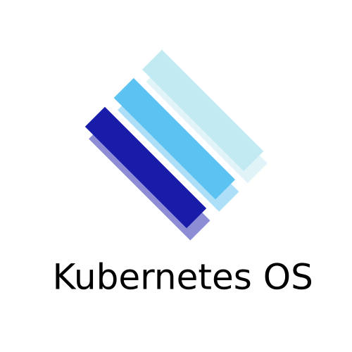

<p align="center">
  <a href="" rel="noopener">
 </a>
</p>

<h3 align="center">KuberneticOS</h3>

<div align="center">

[]()
[](https://github.com/gbozo/kuberneticos/issues)
[](https://github.com/gbozo/kuberneticos/pulls)
[](/LICENSE)

</div>

---

<p align="center"> KuberneticOS is a Web Desktop for Kubernetes. It has a real window
manager written in React and mimics/acts like a real desktop — the resemblance to
Microsoft Windows is deliberate. The goal is to give users a familiar environment
in which to explore and manage a Kubernetes cluster. Windows, macOS, GNOME and KDE
themes are included.
    <br>
</p>

## About

KuberneticOS is a browser desktop environment for Kubernetes. A taskbar, start
menu, focus-aware resizable windows and a right-click context menu form the shell;
"applications" running inside windows talk to a cluster through a single typed
client layer.

Shipped:

- A **Task Manager** window app in the style of the Windows 11 Task Manager: a
  left icon rail (Workloads, Performance, Services, Pods, Namespaces, Nodes,
  with Settings pinned at the rail bottom), a per-page command bar (namespace
  select, Refresh, update speed — Paused / Low 5s / Normal 2s / High 1s) and a
  hero panel with cluster name, version, node count and CPU/Memory/Disk gauges.
  The Workloads page renders a Deployment → ReplicaSet → Pod tree with live
  CPU/Memory/Disk/Network columns; the Performance page charts CPU, memory,
  disk and network over time. Every table row can be **double-clicked (or
  activated with Enter)** to open a right-hand **detail flyout**: workloads show
  a summary with children and pod logs, services show ports, selector and
  backing pods, pods show a summary with labels and logs, and nodes show the
  node detail (capacity, allocatable, conditions and addresses).
- The typed `ClusterClient` surface, all served by the Go API: clusters,
  namespaces, nodes and node detail, deployments / replica sets /
  replication controllers / services, pods (filtered by node, namespace or
  label selector), pod logs and live metrics. Cluster Explorer lists the
  configured clusters; the Task Manager drives the workload, performance,
  services, pods, namespaces and nodes pages.
- Four desktop **themes** (Windows default, macOS, GNOME, KDE) implemented as
  design-token overrides, switchable from the start menu footer.

Live CPU/memory metrics require
[metrics-server](https://github.com/kubernetes-sigs/metrics-server) in the
cluster; without it the API answers `{"available":false, ...}` with HTTP 200 and
the UI shows an `available:false` state (empty metric columns, placeholder
gauges, a "Metrics unavailable" note on Performance). Node and pod disk/network
figures come best-effort from the kubelet Summary API
(`nodes/<name>/proxy/stats/summary`).

The Task Manager can also mutate the cluster (subject to RBAC): **End task**
(`DELETE /api/pods`), **Restart** and **Scale** deployments
(`POST /api/deployments/restart`, `POST /api/deployments/scale`). Every action
is gated by a confirmation dialog and reports RBAC/API errors inline.

Planned:

- A package manager (Helm charts) that installs software into your cluster and
  integrates it with KuberneticOS.

This project is specified in [`spec.md`](spec.md) and documented for contributors
and AI agents in [`agents.md`](agents.md).

## Repository layout

| Path | What it is |
|---|---|
| `src/` | The frontend: TypeScript + React 19 + Vite. Shell components, state model, window apps. |
| `src/state/` | Immutable `DesktopState` reducer + typed event bus. |
| `src/components/ui/` | Small local UI kit (buttons, menus, toggles, icons) that replaced the abandoned `react-uwp`. |
| `src/window-apps/` | Pluggable window applications (TestWindow — dev-only, ClusterExplorer, TaskManager). |
| `src/theme/` | Design tokens + the Windows/macOS/GNOME/KDE theme slots. |
| `src/cluster/` | The one typed cluster-client interface. |
| `server/` | Go JSON API backed by [`k8s.io/client-go`](https://github.com/kubernetes/client-go). |

## 🏁 Getting Started

### Prerequisites

- Node.js 20+ and npm (the app is built with Vite).
- Go 1.26+ (only if you run the cluster server).
- A Kubernetes cluster — or minikube — reachable through a kubeconfig (optional:
  without one the server runs in offline mode).

### Install & run the frontend

```bash
npm install
npm run dev          # Vite dev server, http://localhost:5173
```

The dev server proxies `/api` to the Go server at `http://localhost:8700`
(see `vite.config.ts`).

### Run the cluster server (optional)

```bash
cd server
go run .             # listens on :8700, CORS-restricted JSON API
```

Without cluster configuration the server still starts and answers with
`"source":"offline"` and empty lists, so the web desktop runs either way. See
[`server/README.md`](server/README.md) for endpoints and environment variables.

### Remote apps & Terminal (X-Desktop)

Cluster Explorer can open live sessions into **windows on the desktop**:
**Terminal** is a `kubectl exec` shell via websocket into xterm.js (*Open
terminal*), and pods annotated `kos.dev/x-app: "firefox …"` get an *Open GUI
app* button that renders the app over noVNC. Both ride a single **central shared
X server pod** (`kos-xserver`): app pods stay stock, each kOS window claims one
virtual Xvfb display from its pool.

Deploy the X server from [`deploy/`](deploy/) — build the image
(`docker build -t kos-xserver deploy/xserver`) and apply the manifests
(`kubectl apply -f deploy/`: StatefulSet + RBAC). The server then allocates
sessions from a static display pool (`KOS_XDISPLAY_START` first display, default
`:21`; `KOS_XDISPLAY_POOL` size, default `5`) and bridges the RFB/exec
websockets. **Without `kos-xserver` nothing crashes**: a session request shows a
status overlay with a *Retry* button, and windows opened without a pod target
show an explicit empty state. See [`server/README.md`](server/README.md) and
[`xdesktop-plan.md`](xdesktop-plan.md).

### Production build

```bash
npm run build        # typecheck + vite build → dist/
npm run preview      # serve the production build locally
```

## 🔧 Scripts

| Command | Purpose |
|---|---|
| `npm run dev` | Vite dev server with HMR |
| `npm run build` | `tsc -b && vite build` |
| `npm run preview` | Serve the production build |
| `npm run lint` | ESLint 9 (flat config) |
| `npm run format` / `npm run format:check` | Prettier |
| `npm run test` | Vitest unit tests |
| `npm run e2e` | Playwright end-to-end tests |

## 🎈 Architecture

- **One immutable desktop state.** `src/state/reducer.ts` is a pure reducer over
  `DesktopState` (windows, focus, z-order, start menu, context menu); focus and
  z-order are computed, not stored as CSS hacks.
- **A typed event bus** (`src/state/events.ts`) is the only cross-component
  observation channel (window added/removed/focused, start-menu toggled).
- **Windows** are `react-rnd` elements whose geometry lives in state; the focused
  window is frontmost below the taskbar, blur/minimize/restore are distinct.
- **Cluster access** is centralized in the typed `ClusterClient`
  (`src/cluster/client.ts`): an offline default and an HTTP implementation that
  talks to the Go server. No ad-hoc `fetch` calls in components. Every request
  carries a 15s timeout (`REQUEST_TIMEOUT_MS`) so a stuck `/api` call aborts
  with a clear error instead of hanging a connection forever; the server
  matches that with its own 15s request budget (see `server/README.md`).

## ✍️ Authors

- [@gbozo](https://github.com/gbozo) — idea & initial work.

See also the list of
[contributors](https://github.com/gbozo/kuberneticos/graphs/contributors) who
participated in this project.

## License

GPL-3.0. See [`LICENSE`](LICENSE).
